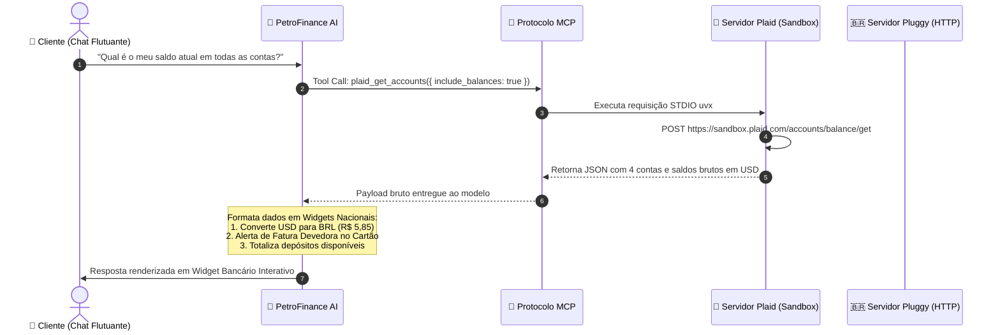

# 🏛️ PetroFinance AI — Assistente Financeiro Inteligente com MCP

[](https://mcp.pluggy.ai/mcp)
[](https://plaid.com)
[](#-metodologia-de-design-at%C3%B4mico)
[](#-carteira-de-investimentos-perfil-moderado)
[](#-paleta-de-cores-e-design-system)
[](#-aviso-legal-e-dados-fict%C3%ADcios)

> Projeto desenvolvido para o Desafio de Projeto **"Criando um Assistente Financeiro com MCP e Open Finance"** da Formação DIO & Banco Bradesco.

---

## 📌 Sumário

1. [Sobre o Projeto e Cenário de Aplicação](#-sobre-o-projeto-e-cen%C3%A1rio-de-aplica%C3%A7%C3%A3o)
2. [Onde o Cliente Já Está e Origem dos Dados](#-onde-o-cliente-j%C3%A1-est%C3%A1-e-origem-dos-dados)
3. [Estrutura da Plataforma e Navegação](#-estrutura-da-plataforma-e-navega%C3%A7%C3%A3o)
   - [Menu Lateral Retrátil (Sidebar)](#menu-lateral-retr%C3%A1til-sidebar)
   - [Header Moderno & Ações Globais](#header-moderno--a%C3%A7%C3%B5es-globais)
   - [Chat Flutuante & Modo Tela Cheia](#chat-flutuante--modo-tela-cheia)
   - [Tela de Login (Autenticação Demonstrativa)](#tela-de-login-autentica%C3%A7%C3%A3o-demonstrativa)
4. [Carteira de Investimentos (Perfil Moderado)](#-carteira-de-investimentos-perfil-moderado)
5. [Paleta de Cores e Design System (Verde Petróleo)](#-paleta-de-cores-e-design-system)
6. [Metodologia de Design Atômico](#-metodologia-de-design-at%C3%B4mico)
7. [Configuração dos Servidores MCP (Pluggy e Plaid)](#-configura%C3%A7%C3%A3o-dos-servidores-mcp)
8. [O Caminho de uma Resposta: Da Pergunta ao Endpoint](#-o-caminho-de-uma-resposta-da-pergunta-ao-endpoint)
9. [Conceitos Essenciais de Open Finance](#-conceitos-essenciais-de-open-finance)
10. [Instalação e Execução Local](#-instala%C3%A7%C3%A3o-e-execu%C3%A7%C3%A3o-local)
11. [Checklist de Submissão e Segurança](#-checklist-de-submiss%C3%A3o-e-seguran%C3%A7a)

---

## 🎯 Sobre o Projeto e Cenário de Aplicação

O **PetroFinance AI** é uma plataforma bancária e assistente financeiro inteligente desenvolvido em React, TypeScript e Tailwind CSS que se conecta a instituições financeiras e bases de conhecimento técnico através do **Model Context Protocol (MCP)**:
- **Pluggy MCP (Streamable HTTP):** Conecta a IA à documentação e schemas oficiais do Open Finance Brasil (`https://mcp.pluggy.ai/mcp`).
- **Plaid MCP (STDIO uvx):** Fornece dados transacionais, saldos consolidados e contas simuladas em ambiente Sandbox.

A plataforma foi desenhada com base em boas práticas modernas de UX/UI, com menu lateral retrátil, header dinâmico, chat flutuante com expansão para tela cheia e módulo dedicado de investimentos.

---

## 🧭 Estrutura da Plataforma e Navegação

### Menu Lateral Retrátil (Sidebar)
O menu lateral expande e colapsa com animação suave, permitindo ao usuário alternar entre as visões da plataforma:
- **Visão Geral (Home):** Posição consolidada de contas correntes, poupanças, depósitos e fatura do cartão com conversão declarada em Reais (R$).
- **Transações & 3 Padrões:** Extrato detalhado com filtros por assinaturas recorrentes, alimentação e varejo, respeitando a convenção contábil da Plaid.
- **Investimentos (Perfil Moderado):** Detalhamento de carteira diversificada de R$ 84.500,00 com gráfico de alocação e rentabilidade de 122% do CDI.
- **Usuários & Perfis:** Gestão de titulares, dependentes de cartão e conectores auditados pelo BACEN.
- **Caminhos & Respostas:** Visualizador do fluxo da requisição MCP do usuário até o endpoint bancário.
- **Configurações MCP:** Modal de inspeção e teste das credenciais Pluggy e Plaid.
- **Botão Sair:** Desconecta o usuário e retorna para a tela de Login.

### Header Moderno & Ações Globais
- **Logotipo Dinâmico:** Se adapta suavemente conforme a sidebar expande e colapsa.
- **Barra de Busca Global:** Para consulta de contas, transações e ativos.
- **Alternador de Moeda:** Exibição simultânea com cotação declarada (US$ 1 = R$ 5,85).
- **Central de Notificações:** Ícone com badge de avisos bancários (faturas, rendimentos do CDB, sincronizações MCP).
- **Perfil do Usuário:** Avatar com nome ("Guilherme Santos"), e-mail demonstrativo e menu dropdown com opção de logout.

### Chat Flutuante & Modo Tela Cheia
O assistente IA opera como um **dock flutuante no canto inferior direito**:
- **Botão FAB Flutuante:** Fica disponível em qualquer tela do sistema com indicador pulsante de status MCP.
- **Janela Flutuante (Dock):** Permite conversar com o assistente enquanto navega pelos gráficos e extratos.
- **Botão Maximizar (Tela Cheia):** Expande o chat para toda a tela, oferecendo amplo espaço para interagir com tabelas financeiras, gráficos comparativos e análises detalhadas.

### Tela de Login (Autenticação Demonstrativa)
- Tela de login com estética verde-petróleo e efeito glassmorphism.
- Credenciais de teste pré-configuradas.
- Botão **"Entrar na Plataforma"** para acesso instantâneo sem fricção.

---

## 📈 Carteira de Investimentos (Perfil Moderado)

O módulo de investimentos simula a carteira de um cliente com perfil **Moderado** (Suitability Bradesco):

- **Patrimônio Total Alocado:** **R$ 84.500,00** (≈ US$ 14.444,44)
- **Rentabilidade Acumulada (12M):** **+13,82%** (122% do CDI)
- **Estratégia de Alocação:**
  1. **35% Renda Fixa Pós-Fixada:** CDB Bradesco Prime 110% CDI (R$ 29.575,00)
  2. **25% Renda Fixa Inflação:** Tesouro IPCA+ 2035 (R$ 21.125,00)
  3. **20% Fundos Imobiliários:** HGLG11 & KNCR11 (R$ 16.900,00)
  4. **15% Ações de Dividendos:** ITSA4, BBSE3, VIVT3 (R$ 12.675,00)
  5. **5% Reserva Internacional:** Plaid Term Certificate em USD (R$ 4.225,00)

---

## 🎨 Paleta de Cores e Design System

O projeto adota a paleta **Verde Petróleo (Deep Teal)**, garantindo contraste conforme as normas **WCAG 2.1 AA/AAA**:

| Token | Código Hex | Função |
| :--- | :---: | :--- |
| **Petrol 950** | `#00241E` | Superfícies escuras |
| **Petrol 900** | `#003830` | Hover states e botões escuros |
| **Petrol 800 (Primária)**| `#004D40` | **Cor Principal da Marca**, barras de navegação e botões primários |
| **Petrol 50 (Surface)** | `#E0F2F1` | Backgrounds suaves de cards e callouts |
| **Amber 600** | `#D97706` | Alerta de fatura/dívida do cartão de crédito |
| **Emerald 600** | `#059669` | Entradas, salários e rentabilidade positiva |

---

## ⚙️ Configuração dos Servidores MCP

### Arquivo `mcp_servers.json`

```json
{
  "mcpServers": {
    "pluggy": {
      "url": "https://mcp.pluggy.ai/mcp",
      "type": "streamable-http"
    },
    "plaid": {
      "command": "uvx",
      "args": ["mcp-server-plaid"],
      "env": {
        "PLAID_CLIENT_ID": "SEU_CLIENT_ID_SANDBOX",
        "PLAID_SECRET": "SEU_SECRET_SANDBOX",
        "PLAID_ENV": "sandbox"
      }
    }
  }
}
```

---

## 🔄 O Caminho de uma Resposta: Da Pergunta ao Endpoint



---

## 💡 Conceitos Essenciais de Open Finance

1. **Por que o Saldo do Cartão é Dívida:** No Open Finance, depósitos são **ativos** e cartões de crédito são **passivos**. O saldo de `$410.00` representa o valor devido da fatura atual e não saldo para saques.
2. **O Conceito de Item na Pluggy:** Representa a conexão autenticada e consentida sob a LGPD entre o cliente e a instituição bancária.
3. **Regra de Sinais na Plaid:** Valores positivos (`+`) são **saídas** (débito) e valores negativos (`-`) são **entradas** (crédito/salário).
4. **Os 3 Padrões de Gasto:** Assinaturas Recorrentes, Alimentação & Delivery e Varejo & Serviços.

---

## 🚀 Instalação e Execução Local

```bash
# 1. Clonar o repositório
git clone https://github.com/guisantoshub/DIO-Assistente-financeiro.git
cd DIO-Assistente-financeiro

# 2. Instalar dependências
npm install

# 3. Executar em modo desenvolvimento
npm run dev
```

Acesse em seu navegador: **`http://localhost:5173/`**

---

## 🛡️ Checklist de Submissão e Segurança

- [x] **Aviso de Dados Fictícios:** Banner fixo no topo e rodapé declarando ambiente sandbox.
- [x] **Nenhuma Chave Versionada:** `.env` protegido pelo `.gitignore`.
- [x] **Menu Lateral Retrátil e Header Dinâmico:** Responsivo para desktop e mobile.
- [x] **Investimentos com Perfil Moderado:** 5 classes de ativos e rentabilidade de 122% do CDI.
- [x] **Chat Flutuante com Maximizar:** Opera como dock flutuante ou tela cheia.
- [x] **Build sem Erros:** Compilado e testado com TypeScript estrito (`npm run build`).

---

<p align="center">
  Desenvolvido com excelência técnica para o <strong>Desafio DIO & Bradesco</strong>.
</p>
