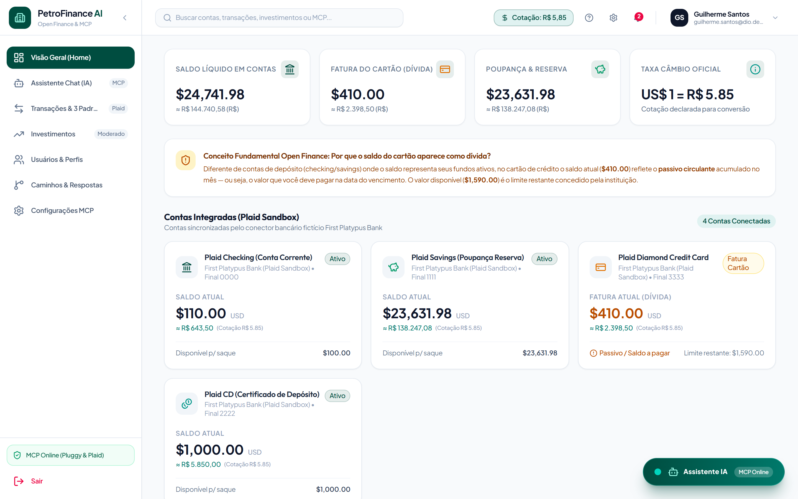
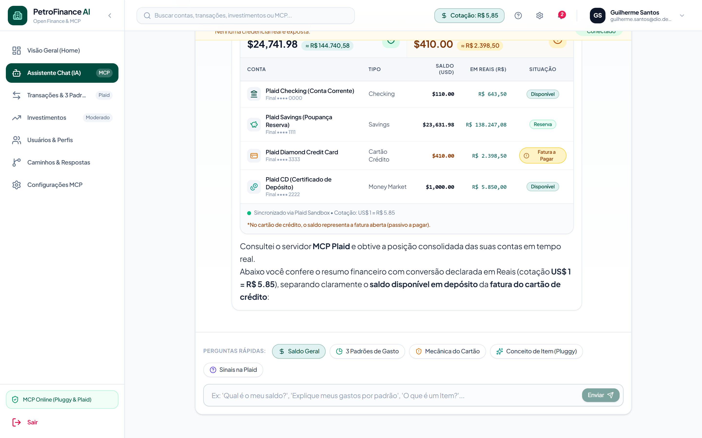
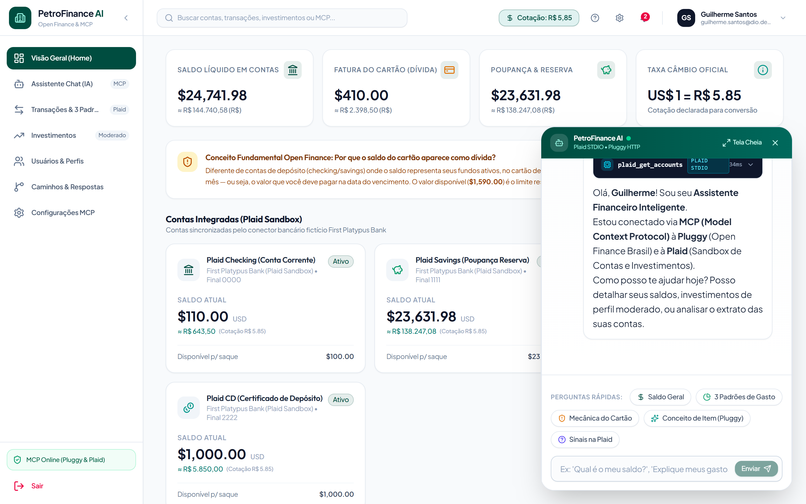
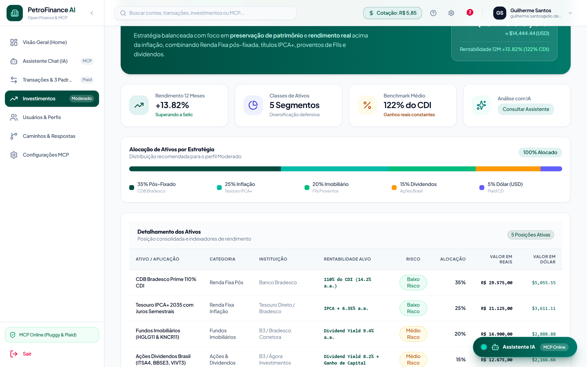
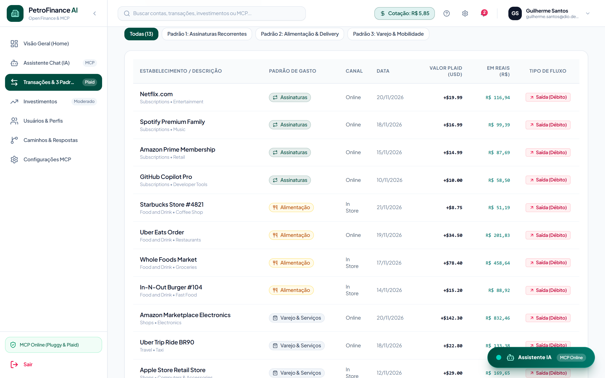
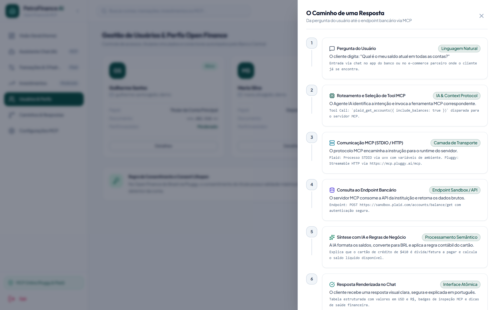
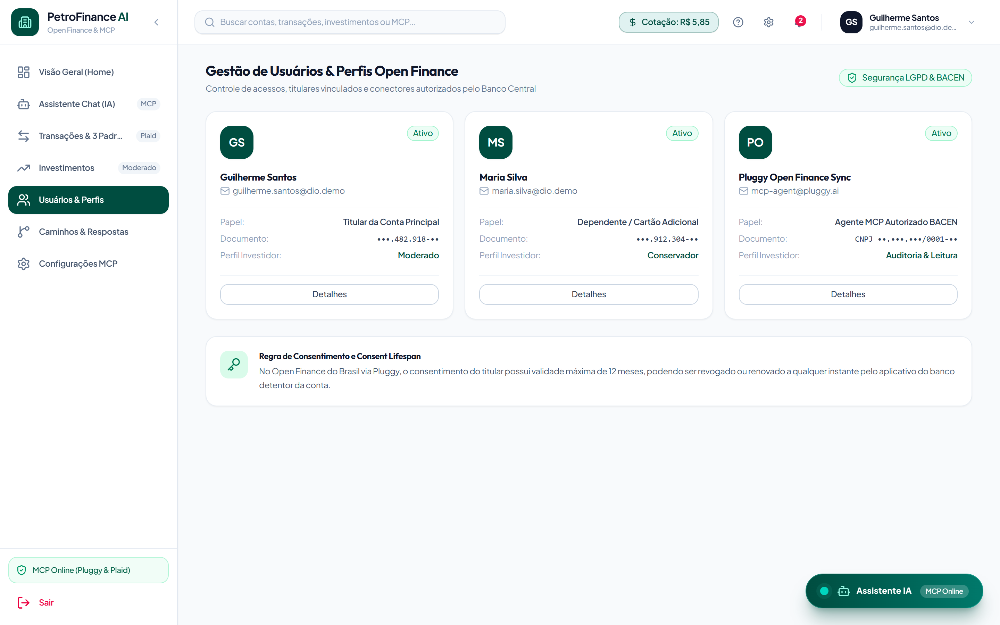
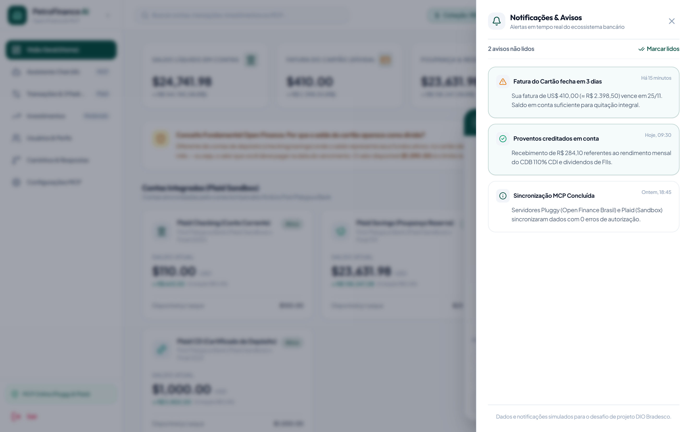

# 🏛️ PetroFinance AI — Assistente Financeiro Inteligente com MCP

[](https://mcp.pluggy.ai/mcp)
[](https://plaid.com)
[](#-o-que-a-plataforma-faz-funcionalidades-com-telas-reais)
[](#4-carteira-de-investimentos-perfil-moderado)
[](#-seguran%C3%A7a-e-dados-fict%C3%ADcios)

> Projeto desenvolvido para o Desafio **"Criando um Assistente Financeiro com MCP e Open Finance"** da Formação DIO & Banco Bradesco.

O **PetroFinance AI** leva o banco até onde o cliente já está: uma plataforma financeira moderna com assistente inteligente conversacional integrado via **Model Context Protocol (MCP)** à **Pluggy** (Open Finance Brasil) e à **Plaid** (Sandbox de Contas, Extratos e Investimentos).

---

## 📸 O Que a Plataforma Faz (Funcionalidades com Telas Reais)

---

### 1. Visão Geral de Saldos e Contas Bancárias (Home)
Consolida em tempo real todas as contas de depósito e linhas de crédito conectadas via MCP.



- **Saldos em Moeda Dupla:** Exibição simultânea em Dólar (USD) e Reais (BRL com cotação declarada de R$ 5,85).
- **Educação Financeira:** Separação clara entre **ativos** (saldo disponível em conta corrente, poupança e CD) e **passivos** (fatura aberta do cartão de crédito).
- **Banner Pedagógico:** Alerta contextual explicando por que o saldo do cartão aparece como dívida e qual é o limite restante disponível para compras.

---

### 2. Assistente Financeiro IA Integrado (Modo Tela Cheia)
Um assistente financeiro conversacional em português que consulta os servidores MCP sob demanda.



- **Widgets Bancários Nativos:** Em vez de texto cru de markdown com barras, as respostas são formatadas em **cards visuais nativos** com métricas de depósito, faturas e tabelas com ícones por instituição.
- **Inspecionador de Chamadas MCP:** Permite auditar em tempo real cada ferramenta executada (`plaid_get_accounts`, `pluggy_search_docs`), com tempo de resposta em milissegundos, parâmetros enviados e endpoint acionado.
- **Perguntas Rápidas (1-Clique):** Pílulas interativas para tirar dúvidas sobre saldo geral, padrões de consumo, regra de sinais e documentação de Open Finance.
- **Integrado à Tela:** Exibido com o menu lateral e o cabeçalho visíveis, com botão para alternar para o widget flutuante quando desejar.

---

### 3. Assistente Flutuante (Widget Multitarefa)
Para permitir que o cliente consulte o assistente enquanto navega por extratos e investimentos.



- **Botão FAB no Canto Inferior Direito:** Fica disponível em qualquer tela da plataforma com indicador de pulso luminoso verde.
- **Dock Lateral:** Permite tirar dúvidas pontuais sem sair da tela de extrato ou carteira.
- **Botão "Tela Cheia":** Com um clique, transiciona suavemente o chat para a visão completa integrada ao layout.

---

### 4. Carteira de Investimentos (Perfil Moderado)
Gestão completa de patrimônio alocado seguindo as diretrizes de suitability do Bradesco para investidores moderados.



- **Patrimônio Total:** **R$ 84.500,00** (≈ US$ 14.444,44) distribuídos estrategicamente.
- **Rentabilidade Acumulada:** **+13,82% nos últimos 12 meses** (representando **122% do CDI**).
- **Barra de Alocação de Ativos:**
  - `35%` Renda Fixa Pós-Fixada: CDB Bradesco Prime 110% CDI (R$ 29.575,00)
  - `25%` Renda Fixa Inflação: Tesouro IPCA+ 2035 (R$ 21.125,00)
  - `20%` Fundos Imobiliários: FIIs HGLG11 & KNCR11 (R$ 16.900,00)
  - `15%` Ações de Dividendos: ITSA4, BBSE3, VIVT3 (R$ 12.675,00)
  - `5%` Dólar: Plaid Term Certificate em USD (R$ 4.225,00)
- **Consultoria com IA:** Botão direto para solicitar à IA uma análise preditiva e de risco da carteira.

---

### 5. Extrato Inteligente e os 3 Padrões de Gasto
Análise transacional profunda que classifica automaticamente as despesas recentes.



- **Os 3 Padrões de Gasto da DIO:**
  1. **Assinaturas Recorrentes:** Netflix, Spotify, GitHub Copilot, Amazon Prime.
  2. **Alimentação & Delivery:** Starbucks, Uber Eats, Whole Foods, In-N-Out Burger.
  3. **Varejo & Mobilidade:** Amazon Marketplace, Apple Store, Uber Trip, CVS Pharmacy.
- **Tratamento da Regra de Sinais da Plaid:** Card destacado explicando visualmente que **valores positivos (`+`) são SAÍDAS/DÉBITOS** e **valores negativos (`-`) são ENTRADAS/SALÁRIOS** (como a folha TechCorp de `-$2.500,00`).

---

### 6. "O Caminho da Resposta" (Transparência MCP)
Painel interativo que detalha a esteira técnica percorrida entre a pergunta do cliente e a entrega do dado financeiro.



- **Etapa 1:** Pergunta em linguagem natural do cliente.
- **Etapa 2:** Agente IA interpreta a intenção e seleciona a ferramenta MCP correspondente.
- **Etapa 3:** Camada de transporte MCP (STDIO uvx para Plaid / HTTP para Pluggy).
- **Etapa 4:** Consulta segura ao endpoint da instituição bancária na Sandbox.
- **Etapa 5:** Síntese semântica com aplicação das regras contábeis e conversão para Reais.
- **Etapa 6:** Renderização na interface através de componentes do Design Atômico.

---

### 7. Gestão de Usuários e Perfis Open Finance
Visão administrativa dos titulares da conta e conectores autorizados sob a LGPD.



- **Perfis Vinculados:** Titular principal (**Guilherme Santos**), dependente de cartão adicional (**Maria Silva**) e o bot de auditoria da Pluggy.
- **Consentimento Bancário:** Explicação do ciclo de vida do consentimento BACEN (validade máxima de 12 meses renovável).

---

### 8. Central de Notificações e Avisos Bancários
Gaveta lateral acessível pelo ícone de sino no cabeçalho com avisos automáticos.


- Alertas em tempo real sobre fechamento de fatura de cartão.
- Notificação de proventos creditados de CDB e dividendos de FIIs.
- Status da sincronização automática dos servidores MCP.

---

### 9. Acesso Demonstrativo (Tela de Login)
Tela de autenticação moderna em verde-petróleo com efeito glassmorphism.



- Acesso imediato em 1 clique através do botão **"Entrar na Plataforma"** para testadores e avaliadores.
- Botão **"Sair"** no menu lateral e no menu do usuário para retornar ao login a qualquer momento.

---

## ⚡ Configuração dos Servidores MCP (Resumida)

O arquivo [`mcp_servers.json`](mcp_servers.json) na raiz do projeto está pronto para uso no **Antigravity**, **Claude Desktop** ou **Codex**:

```json
{
  "mcpServers": {
    "pluggy": {
      "url": "https://mcp.pluggy.ai/mcp",
      "type": "streamable-http"
    },
    "plaid": {
      "command": "uvx",
      "args": ["mcp-server-plaid"],
      "env": {
        "PLAID_CLIENT_ID": "SEU_CLIENT_ID_SANDBOX",
        "PLAID_SECRET": "SEU_SECRET_SANDBOX",
        "PLAID_ENV": "sandbox"
      }
    }
  }
}
```

---

## 🚀 Como Executar Localmente

```bash
# 1. Clonar o repositório
git clone https://github.com/guisantoshub/DIO-Assistente-financeiro.git
cd DIO-Assistente-financeiro

# 2. Instalar dependências
npm install

# 3. Iniciar a aplicação
npm run dev
```

Acesse no seu navegador: **`http://localhost:5173/`**

---

## 🛡️ Segurança e Dados Fictícios

- **100% de Dados Fictícios:** Todas as contas, transações, investimentos e notificações utilizam dados simulados da Sandbox da Plaid (`First Platypus Bank`) e documentação oficial da Pluggy.
- **Zero Segredos Expostos:** Nenhuma chave real de API, token ou credencial bancária está versionada no repositório. O `.env` está protegido pelo `.gitignore`.
- **Acessibilidade:** Cores projetadas com contraste em Verde Petróleo (`#004D40`) atendendo às normas **WCAG 2.1 AA/AAA**.

---

<p align="center">
  Desenvolvido com excelência técnica para o <strong>Desafio de Projeto DIO & Bradesco</strong>.
</p>
