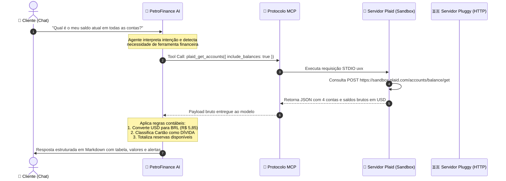

# 🏛️ PetroFinance AI — Assistente Financeiro Inteligente com MCP

[](https://mcp.pluggy.ai/mcp)
[](https://plaid.com)
[](#-metodologia-de-design-at%C3%B4mico)
[](#-paleta-de-cores-e-design-system)
[](#-aviso-legal-e-dados-fict%C3%ADcios)

> Projeto desenvolvido para o Desafio de Projeto **"Criando um Assistente Financeiro com MCP e Open Finance"** da Formação DIO & Banco Bradesco.

---

## 📌 Sumário

1. [Sobre o Projeto e Cenário de Aplicação](#-sobre-o-projeto-e-cen%C3%A1rio-de-aplica%C3%A7%C3%A3o)
2. [Onde o Cliente Já Está e Origem dos Dados](#-onde-o-cliente-j%C3%A1-est%C3%A1-e-origem-dos-dados)
3. [Paleta de Cores e Design System (Verde Petróleo)](#-paleta-de-cores-e-design-system)
4. [Metodologia de Design Atômico](#-metodologia-de-design-at%C3%B4mico)
5. [Configuração dos Servidores MCP (Pluggy e Plaid)](#-configura%C3%A7%C3%A3o-dos-servidores-mcp)
6. [O Caminho de uma Resposta: Da Pergunta ao Endpoint](#-o-caminho-de-uma-resposta-da-pergunta-ao-endpoint)
7. [Conceitos Essenciais de Open Finance](#-conceitos-essenciais-de-open-finance)
   - [Por que o Saldo do Cartão Aparece como Dívida?](#1-por-que-o-saldo-do-cart%C3%A3o-aparece-como-d%C3%ADvida)
   - [O que é um "Item" na Pluggy?](#2-o-que-%C3%A9-um-item-na-pluggy)
   - [Convenção de Sinais na Plaid API](#3-conven%C3%A7%C3%A3o-de-sinais-na-plaid-api)
   - [Os 3 Padrões de Gasto](#4-os-3-padr%C3%B5es-de-gasto-identificados)
8. [Telas do Aplicativo e Demonstração](#-telas-do-aplicativo-e-demonstra%C3%A7%C3%A3o)
9. [Instalação e Execução Local](#-instala%C3%A7%C3%A3o-e-execu%C3%A7%C3%A3o-local)
10. [Checklist de Submissão e Segurança](#-checklist-de-submiss%C3%A3o-e-seguran%C3%A7a)

---

## 🎯 Sobre o Projeto e Cenário de Aplicação

O **PetroFinance AI** é uma aplicação web em formato de chat conversacional alimentada por Inteligência Artificial que consome dados bancários e schemas técnicos através do protocolo aberto **Model Context Protocol (MCP)**. 

Em vez de forçar o usuário a navegar por dezenas de menus bancários ou consultar APIs proprietárias com código complexo, o assistente orquestra duas pontes MCP em tempo real:
- **Pluggy MCP (Streamable HTTP):** Conecta a IA à documentação e aos conceitos oficiais do Open Finance Brasil (como consentimento, conectores e agregação de *Items*).
- **Plaid MCP (STDIO uvx):** Fornece dados transacionais, saldos consolidados e histórico de contas em ambiente de Sandbox segura.

---

## 🛒 Onde o Cliente Já Está e Origem dos Dados

### Cenário de Uso
O cliente encontra-se na **etapa de checkout de uma plataforma de compras e viagens (E-commerce / Agência de Turismo)**. No momento de decidir como parcelar uma viagem ou realizar uma compra de alto valor, ele não precisa sair do site para abrir o aplicativo do banco e consultar seus limites:
- O assistente reside em uma gaveta conversacional acessível no checkout.
- O cliente pergunta: *"Tenho saldo para essa passagem de R$ 2.000 ou compensa usar o cartão?"*
- O assistente consulta as contas em segundos, avisa o limite disponível no cartão, compara com a reserva na poupança e explica o impacto contábil.

### Origem de Cada Dado
| Informação Solicitada | Fonte Primária | Protocolo MCP | Endpoint / Mecanismo |
| :--- | :--- | :--- | :--- |
| **Saldos de Corrente e Poupança** | Plaid Sandbox | STDIO (`uvx mcp-server-plaid`) | `POST /accounts/balance/get` |
| **Fatura e Limite do Cartão** | Plaid Sandbox | STDIO (`uvx mcp-server-plaid`) | `POST /accounts/balance/get` |
| **Extrato e Padrões de Consumo** | Plaid Sandbox | STDIO (`uvx mcp-server-plaid`) | `POST /transactions/get` |
| **Conceito de Item e Conectores BR**| Pluggy Oficial | Streamable HTTP | `GET https://mcp.pluggy.ai/mcp` |
| **Conversão Cambial (USD → BRL)** | Cotação Declarada | Frontend / Chat Engine | Taxa declarada (R$ 5,85) |

---

## 🎨 Paleta de Cores e Design System

O projeto adota uma estética **moderna, minimalista e profissional**, estruturada em torno do **Verde Petróleo (Deep Petrol Green / Dark Teal)**. A paleta foi rigorosamente calibrada para atender às normas de acessibilidade **WCAG 2.1 AA/AAA** (contraste mínimo de 4.5:1 para texto normal e 3:1 para elementos de interface).

### Tokens de Cores Principais

| Token | Código Hexadecimal | Função Semântica | Contraste / Acessibilidade |
| :--- | :---: | :--- | :--- |
| **Petrol 950** | `#00241E` | Superfícies escuras e fundos contrastantes | Alto contraste |
| **Petrol 900** | `#003830` | Hover states e cabeçalhos escuros | WCAG AAA sobre branco |
| **Petrol 800 (Primária)**| `#004D40` | **Cor Principal da Marca**, botões, acentos | WCAG AAA (7.8:1 sobre branco) |
| **Petrol 700** | `#00695C` | Destaques intermediários e bordas ativas | WCAG AA |
| **Petrol 500** | `#00897B` | Badges, ícones e estados ativos | Contraste equilibrado |
| **Petrol 50 (Surface)** | `#E0F2F1` | Backgrounds suaves de cards e callouts | Conforto visual |
| **Amber Warning** | `#B45309` | Alerta de fatura/dívida do cartão de crédito | Destaque pedagógico |
| **Emerald Success** | `#047857` | Entradas, salários e conexões ativas | Semântica positiva |

### Tipografia Profissional
- **Família Display / Headings:** `Outfit` (geométrica, moderna e amigável).
- **Família Textos & Interface:** `Plus Jakarta Sans` (alta legibilidade em telas e densidade de informação limpa).

---

## 🧱 Metodologia de Design Atômico

A aplicação foi desenvolvida seguindo estritamente a metodologia **Atomic Design** de Brad Frost, permitindo escalabilidade, reusabilidade e independência entre camadas:

```
src/components/
├── atoms/                # Elementos indivisíveis
│   ├── Avatar.tsx        # Avatar do assistente (gradiente petróleo) e usuário
│   ├── Badge.tsx         # Pílulas semânticas de status (MCP, Ativo, Fatura)
│   ├── Button.tsx        # Botões acessíveis (Primary petróleo, Secondary, Ghost)
│   ├── Card.tsx          # Containers modulares com bordas refinadas
│   └── Input.tsx         # Campos de formulário com foco anelar em verde petróleo
│
├── molecules/            # Combinações de átomos com propósito funcional
│   ├── AccountCard.tsx   # Card bancário com conversão USD/BRL e selo de dívida
│   ├── MetricCard.tsx    # Card estatístico com ícone, valor e subtítulo
│   ├── MCPCallBadge.tsx  # Inspecionador colapsável de chamadas de ferramenta MCP
│   └── QuickPrompts.tsx  # Pílulas de perguntas de um clique para teste rápido
│
├── organisms/            # Seções completas e funcionais da interface
│   ├── ChatWindow.tsx    # Interface conversacional com stream e formatação Markdown
│   ├── AccountsOverview.tsx # Grid de contas integradas e banner pedagógico
│   ├── TransactionsTable.tsx# Tabela com filtro dos 3 padrões e regra de sinais
│   ├── MCPConfigModal.tsx# Modal de configuração e teste dos servidores MCP
│   ├── ArchitectureDrawer.tsx # Gaveta visual "O Caminho da Resposta"
│   └── Navbar.tsx        # Cabeçalho com status MCP e troca de moeda
│
├── templates/            # Estruturas de layout responsivo
│   └── MainLayout        # Enquadramento flexível com suporte mobile/desktop
│
└── services/ & data/     # Regras de negócio, datasets e engines MCP
    ├── chatEngine.ts     # Processador semântico das perguntas em português
    ├── liveMcpClient.ts  # Cliente de transporte para ferramentas MCP
    └── mockData.ts       # Base de dados idêntica à Sandbox da Plaid
```

---

## ⚙️ Configuração dos Servidores MCP

O projeto implementa e documenta a configuração dos dois servidores MCP exigidos no desafio, prontos para uso no **Antigravity**, **Claude Desktop**, **Codex** ou qualquer cliente compatível com MCP.

### Arquivo `mcp_servers.json`

```json
{
  "mcpServers": {
    "pluggy": {
      "url": "https://mcp.pluggy.ai/mcp",
      "type": "streamable-http"
    },
    "plaid": {
      "command": "uvx",
      "args": ["mcp-server-plaid"],
      "env": {
        "PLAID_CLIENT_ID": "SEU_CLIENT_ID_SANDBOX",
        "PLAID_SECRET": "SEU_SECRET_SANDBOX",
        "PLAID_ENV": "sandbox"
      }
    }
  }
}
```

### Passo a Passo no Windows (PowerShell)

1. **Instalar o `uv` (gerenciador de ferramentas Python):**
   ```powershell
   powershell -ExecutionPolicy ByPass -c "irm https://astral.sh/uv/install.ps1 | iex"
   ```

2. **Obter as chaves da Plaid:**
   - Acesse o [Dashboard da Plaid](https://dashboard.plaid.com/developers/keys).
   - Copie o `client_id` e o `secret` da seção **Sandbox**.

3. **Conectar a Pluggy:**
   - Não requer chaves de autenticação no servidor público Streamable HTTP.
   - Endpoint: `https://mcp.pluggy.ai/mcp`.

---

## 🔄 O Caminho de uma Resposta: Da Pergunta ao Endpoint

Quando o usuário pergunta *"Qual é o meu saldo?"*, o fluxo completo de dados ocorre em 6 etapas:



### Detalhamento das Etapas

| Etapa | Responsável | Ação Realizada | Detalhe Técnico |
| :---: | :--- | :--- | :--- |
| **1** | **Usuário** | Digita pergunta em linguagem natural | *"Qual é o meu saldo atual?"* |
| **2** | **Agente IA** | Roteamento de Tool Calling | Seleciona `plaid_get_accounts` |
| **3** | **Camada MCP** | Transporte via STDIO ou HTTP | Protocolo de contexto padronizado |
| **4** | **Endpoint API**| Consulta à Sandbox | `POST https://sandbox.plaid.com/accounts/balance/get` |
| **5** | **Síntese IA** | Aplicação de regras contábeis | Isola saldo do cartão como passivo e converte p/ R$ |
| **6** | **Frontend** | Renderização com componentes atômicos | Tabela formatada e inspecionador de latência |

---

## 💡 Conceitos Essenciais de Open Finance

### 1. Por que o Saldo do Cartão Aparece como Dívida?
Em APIs bancárias e no Open Finance, contas de depósito (corrente e poupança) representam **ativos** (fundos que pertencem ao cliente). Já o cartão de crédito é uma linha de empréstimo rotativo, configurando um **passivo**.

Quando o cartão *Plaid Diamond* exibe **$410.00**, significa que o cliente utilizou **$410.00 do seu limite de crédito**, valor este que deverá ser quitado na fatura. O limite que ele ainda pode gastar é o disponível (**$1.590,00** de um teto de $2.000,00).

### 2. O que é um "Item" na Pluggy?
Na documentação da Pluggy (`https://mcp.pluggy.ai/mcp`), um **Item** é o registro digital que representa a **conexão autenticada e consentida entre um usuário e uma instituição financeira**. Sob um mesmo Item, múltiplas contas (corrente, poupança, cartão e investimentos) são descobertas e sincronizadas automaticamente respeitando a LGPD e as normas do Banco Central do Brasil.

### 3. Convenção de Sinais na Plaid API
A Plaid utiliza a regra contábil dos balanços financeiros:
- 🔴 **Valor Positivo (`+amount`):** Representa **SAÍDA de dinheiro (Débito / Despesa)**.
  - Exemplo: Compra na Netflix de `$19.99` é informada como `+19.99`.
- 🟢 **Valor Negativo (`-amount`):** Representa **ENTRADA de dinheiro (Crédito / Depósito)**.
  - Exemplo: O salário recebido da TechCorp entra como `-2500.00`.

### 4. Os 3 Padrões de Gasto Identificados

| Padrão de Gasto | Categoria | Exemplos Práticos | Valor Médio | Comportamento |
| :--- | :--- | :--- | :---: | :--- |
| **1. Assinaturas Recorrentes** | Softwares e Streaming | Netflix, Spotify, Amazon Prime, Copilot | ~$61,97 USD | Cobranças mensais fixas no cartão |
| **2. Alimentação & Delivery** | Restaurantes e Mercado | Starbucks, Uber Eats, Whole Foods, In-N-Out | ~$136,85 USD | Gastos rotineiros e essenciais |
| **3. Varejo & Mobilidade** | Compras e Transporte | Amazon Electronics, Apple, Uber Trip, CVS | ~$226,25 USD | Despesas variáveis e pontuais |

---

## 📱 Telas do Aplicativo e Demonstração

### Tela 1: Assistente Financeiro Inteligente (Chat + Inspecionador MCP)
O chat exibe a saudação inicial, as pílulas de perguntas rápidas, os badges de latência em milissegundos das chamadas `plaid_get_accounts` e `pluggy_search_docs`, e respostas organizadas com tabelas.

```
+-----------------------------------------------------------------------------------+
|  🏛️ PetroFinance AI  [MCP Assist]            [Exibindo em R$]  [Caminho] [Config] |
+-----------------------------------------------------------------------------------+
|  ⚠️ Ambiente Sandbox de Demonstração: Dados fictícios simulados.   [🛡️ MCP Conectado]|
|                                                                                   |
|  🤖 PetroFinance AI:                                                              |
|     Consultei o servidor MCP Plaid e obtive a posição consolidada das contas:     |
|                                                                                   |
|     +-------------------+-----------+-----------------+-----------------+         |
|     | Conta             | Tipo      | Saldo USD       | Em Reais (R$)   |         |
|     +-------------------+-----------+-----------------+-----------------+         |
|     | Plaid Checking    | Corrente  | $110.00         | R$ 643,50       |         |
|     | Plaid Savings     | Poupança  | $23,631.98      | R$ 138.247,08   |         |
|     | Plaid Diamond     | Cartão    | $410.00 (Fatura)| R$ 2.398,50 ⚠️  |         |
|     +-------------------+-----------+-----------------+-----------------+         |
|                                                                                   |
|  [Pílulas Rápidas]: [Saldo Geral] [3 Padrões de Gasto] [Por que Cartão é Dívida?] |
|  [Digite sua dúvida sobre contas, limites ou documentação...]            [Enviar] |
+-----------------------------------------------------------------------------------+
```

### Tela 2: Painel Consolidado de Contas & Saldos
Apresenta cards detalhados por instituição, conversão cambial simultânea em Reais (R$), limite remanescente e o banner explicativo sobre o passivo circulante do cartão de crédito.

### Tela 3: Extrato Analítico dos 3 Padrões de Consumo
Tabela interativa com filtros rápidos por categoria, detalhamento de canal (In-store vs Online) e conversão clara do sinal contábil da Plaid.

### Tela 4: Modal de Configuração e Teste MCP
Permite visualizar as credenciais de Sandbox, testar a conectividade com feedback em tempo real e copiar o JSON pronto para o Antigravity ou Codex.

### Tela 5: Gaveta do Caminho da Resposta (Arquitetura)
Visualizador do ciclo de vida da requisição (do input do usuário à ferramenta MCP e endpoint da API).

---

## 🚀 Instalação e Execução Local

### Pré-requisitos
- **Node.js** v18 ou superior instalado.
- Gerenciador de pacotes **npm** ou **pnpm**.

### Passo a Passo

1. **Clonar o repositório:**
   ```bash
   git clone https://github.com/SEU_USUARIO/assistente-financeiro-dio.git
   cd assistente-financeiro-dio
   ```

2. **Instalar as dependências:**
   ```bash
   npm install
   ```

3. **Configurar variáveis de ambiente (Opcional):**
   ```bash
   cp .env.example .env
   ```

4. **Executar em modo de desenvolvimento:**
   ```bash
   npm run dev
   ```
   Acesse a URL indicada (ex: `http://localhost:5173`) no seu navegador.

5. **Gerar build de produção:**
   ```bash
   npm run build
   ```

---

## 🛡️ Checklist de Submissão e Segurança

- [x] **Aviso de Dados Fictícios:** Presente em banner visível no topo e no rodapé do chat.
- [x] **Nenhuma Chave Versionada:** Variáveis de ambiente isoladas em `.gitignore`; `.env.example` sem credenciais reais.
- [x] **Design Atômico e Acessibilidade:** Componentes modulares (átomos, moléculas, organismos) com conformidade WCAG AA.
- [x] **Explicação dos Padrões e Regras:** 3 padrões de gastos cobertos, sinal contábil Plaid e mecânica do cartão documentados.
- [x] **Configuração MCP Completa:** Arquivos e instruções para Pluggy HTTP e Plaid STDIO uvx inclusos.
- [x] **Build sem Erros:** Testado com TypeScript estrito (`tsc -b && vite build`) concluído com sucesso.

---

<p align="center">
  Desenvolvido com excelência técnica para o <strong>Desafio DIO & Bradesco</strong>.
</p>
