# PetroFinance — Assistente Financeiro DIO & Bradesco

Uma experiência financeira minimalista para acompanhar contas, extrato e investimentos, com um assistente conversacional demonstrativo.

**Aplicação:** [diobrad-desafio.vercel.app](https://diobrad-desafio.vercel.app)

**Projeto Vercel:** `dio-desafiobrad` · conta Guilhermeguiter

**Repositório:** [guisantoshub/DIO-Assistente-financeiro](https://github.com/guisantoshub/DIO-Assistente-financeiro)

## Experiência

- Menu lateral expansível: **248 px aberto / 80 px recolhido**, mantendo **40 px** entre o menu e o conteúdo em todas as páginas de desktop.
- No celular, navegação inferior e margens adaptadas à tela (20 px; 16 px no chat).
- Assistente com rolagem própria e campo de mensagem visível, tanto em tela completa quanto em janela flutuante. A conversa acompanha a mudança de modo.
- Configurações acessíveis **somente pelo ícone do cabeçalho**. A preferência de conversão em reais e o estado do menu ficam salvos no navegador.
- Extrato com filtros de categoria e sinais familiares: **+ entradas / − saídas**. Os dados de origem mantêm a convenção da Plaid internamente.
- Carteira com composição dos ativos, perfis de pessoas e notificações. Detalhes de implementação ficam fora da interface do cliente.

## Telas atuais

Capturas da versão revisada em 22/11/2026. Desktop em 1440 × 900 e celular em 390 × 844; algumas páginas de desktop usam captura de página inteira.

### Visão geral

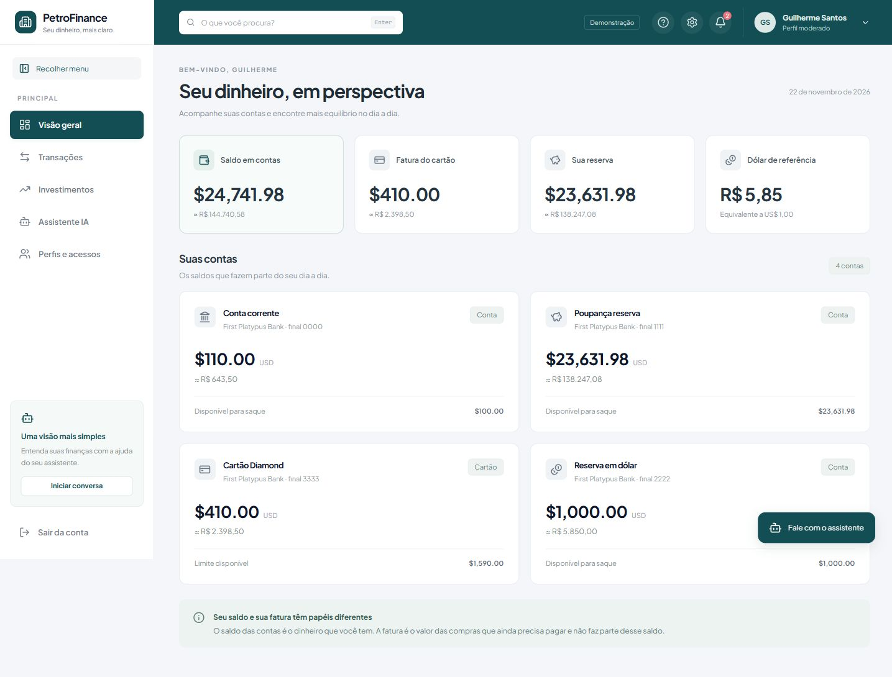

### Assistente e menu recolhido

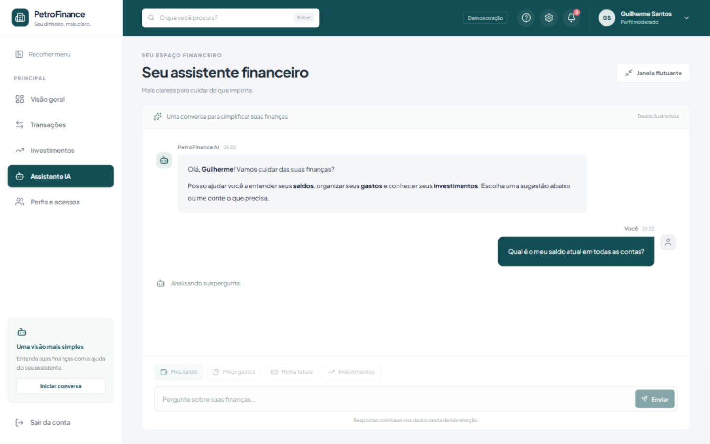

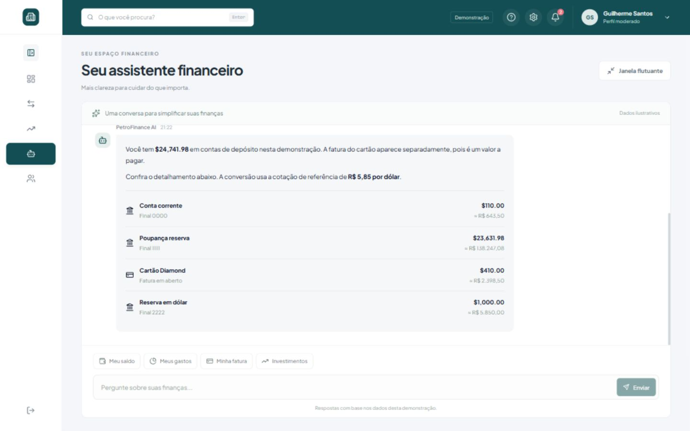

### Investimentos e transações

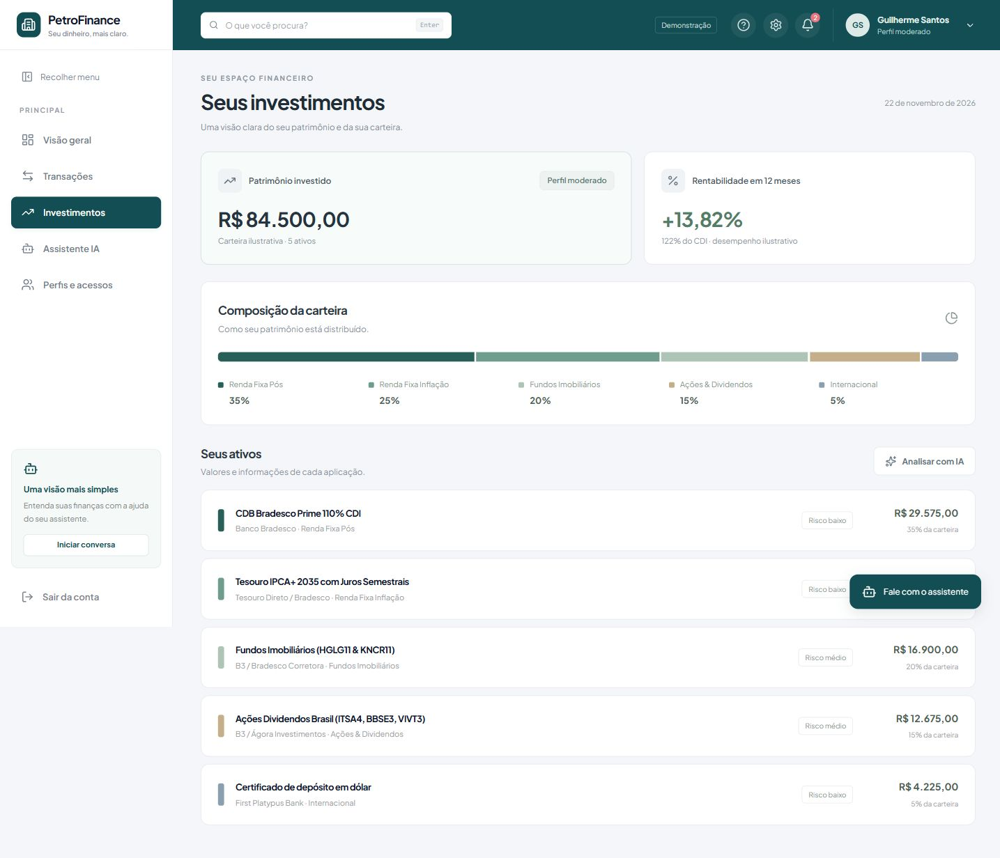

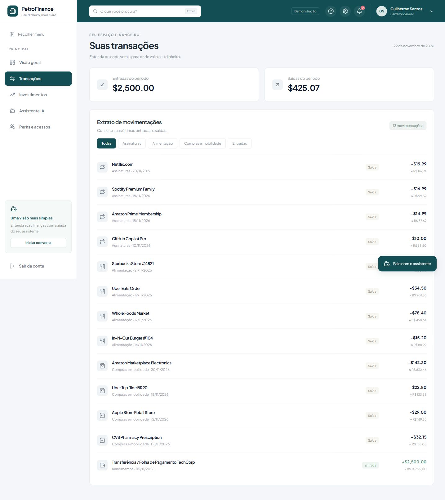

### Perfis, configurações e notificações

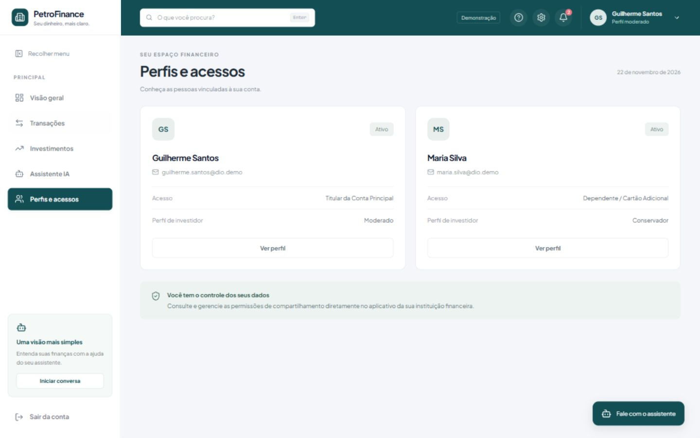

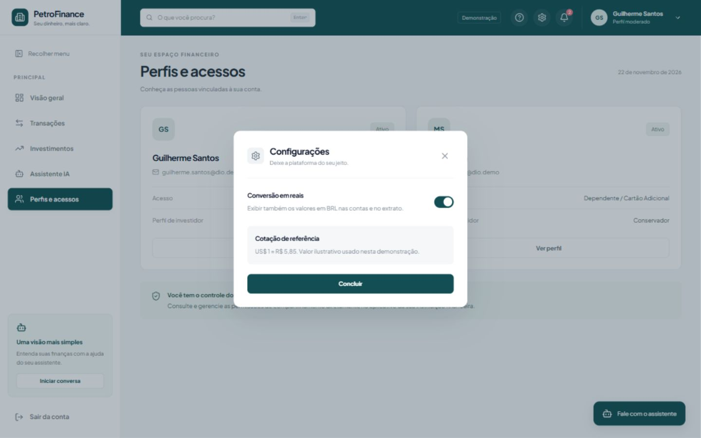

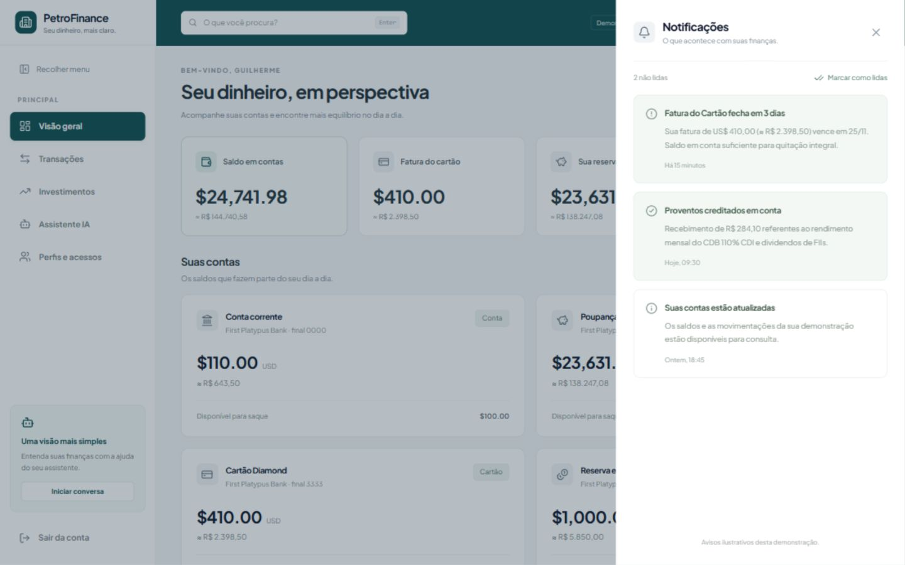

### Janela flutuante e acesso à demonstração

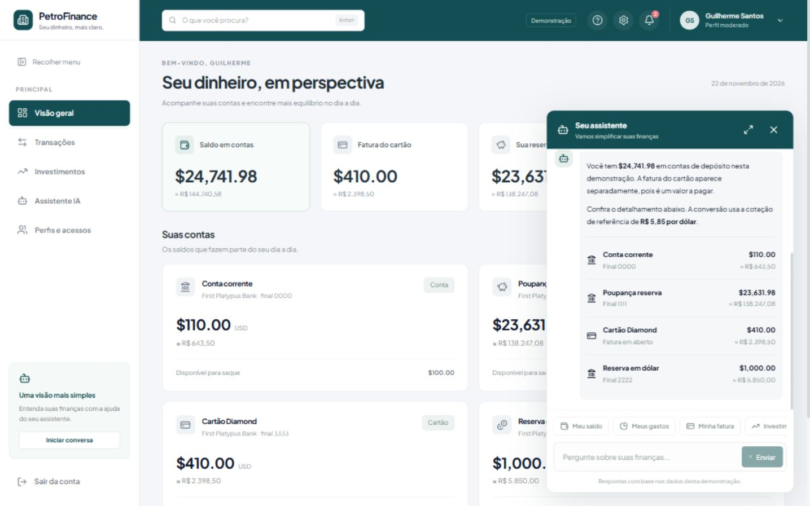

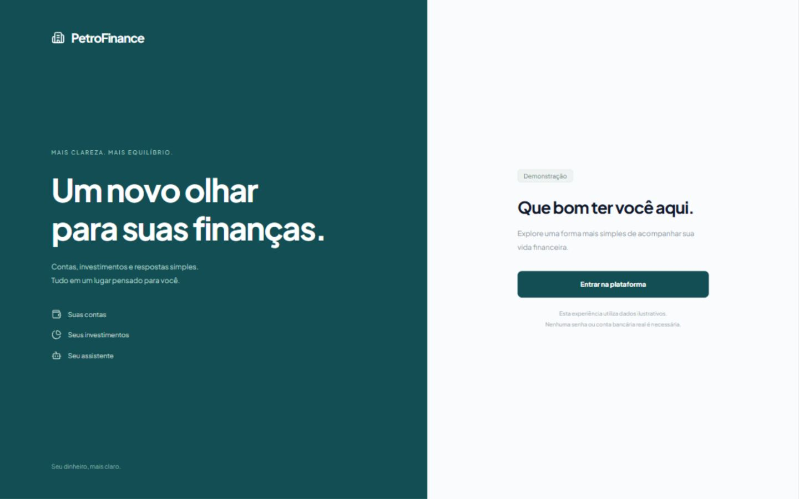

### Experiência mobile

| Visão geral | Assistente | Janela flutuante |
| --- | --- | --- |
| 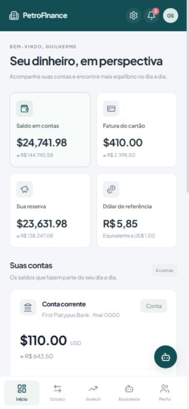 |  |  |

## Execução local

Requer Node.js 24 e npm.

```bash
npm ci
npm run dev
```

Abra [localhost:5173](http://localhost:5173).

```bash
npm run build
npm run lint
```

Para recriar a galeria, mantenha a aplicação local em execução e rode:

```bash
node docs/capture-screens.cjs
```

O script usa uma instância isolada de Chrome ou Edge. É possível informar `CHROME_PATH` e `CAPTURE_URL` por variáveis de ambiente. A validação da revisão está registrada em [docs/validacao-layout.md](docs/validacao-layout.md).

## Publicação e sincronização

A configuração [vercel.json](vercel.json) usa o preset Vite, `npm run build` e o diretório `dist`. O projeto Vercel deve permanecer conectado à branch `main` deste repositório para que os próximos pushes atualizem a aplicação. O domínio de produção é `diobrad-desafio.vercel.app`.

O workflow de GitHub Pages também foi preservado, com Node.js 24. O `base: './'` do Vite permite servir os mesmos arquivos estáticos na Vercel e em um subdiretório do GitHub Pages.

## Dados e arquitetura do desafio

Este projeto é um **protótipo de interface com dados fictícios**. As respostas do assistente são produzidas por regras locais em `src/services/chatEngine.ts`, usando os dados em `src/data/mockData.ts`. Não há chamada a um modelo de IA ou consulta bancária real em produção. O acesso à demonstração não é autenticação bancária.

O arquivo [mcp_servers.json](mcp_servers.json) e o cliente de exemplo `src/services/liveMcpClient.ts` documentam o estudo de MCP, Pluggy e Plaid. O cliente de exemplo também usa simulação; esses arquivos não transformam a interface publicada em uma integração bancária ativa. Ferramentas e parâmetros internos não são exibidos ao cliente.

A conversão de demonstração usa **US$ 1 = R$ 5,85**, sem cotação de mercado ao vivo. Contas, investimentos, rentabilidades, notificações e perfis são ilustrativos. Nenhuma movimentação financeira é executada.

Não adicione chaves bancárias ao código do navegador. Uma futura integração real precisa de autenticação, consentimento e tratamento de credenciais no servidor.
